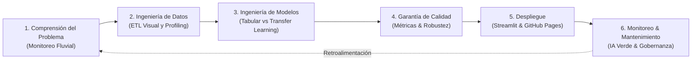

# 🌊 Sistema Inteligente para la Detección y Clasificación de Desechos Sólidos en Ríos

[](https://www.python.org/)
[](https://Proyecto_ML.streamlit.app)
[](https://scikit-learn.org/)
[](https://keras.io/)
[](https://pandas.pydata.org/)
[](https://numpy.org/)
[](https://python-pillow.org/)
[](https://github.com/ydataai/ydata-profiling)
[](https://www.kaggle.com/datasets/siddhantmaji/unified-waste-classification-dataset)
[](https://edauriadon.github.io/Proyecto-ML/)
[](https://opensource.org/licenses/MIT)

---

## 📌 Información Académica
- **Programa:** Maestría en Inteligencia Artificial, Educación e Investigación
- **Asignatura:** Machine Learning
- **Institución:** Universidad Federico Henríquez y Carvajal (UFHEC)
- **Autor:** Edauris Adon Evangelista
- **Matrícula:** MT-2026-02532
- **Fecha:** Noviembre 2026

---

## 🧭 Sumario Ejecutivo
El presente proyecto aborda la problemática crítica de la gestión y acumulación de residuos sólidos en **ríos, arroyos y cañadas urbanas**, mediante la implementación de un prototipo inteligente de Machine Learning supervisado y Visión por Computador. A partir de un conjunto de datos de imágenes, se realiza un proceso de **Extracción de Características (ETL Visual)** para convertir la información cromática y textural no estructurada en 9 variables tabulares continuas, permitiendo su análisis, modelado y comparación frente a una red convolucional profunda mediante **Transfer Learning (MobileNetV2)**.

El ciclo de desarrollo integra:
1. **Exploración de Datos (EDA) y Data Profiling:** Análisis descriptivo y verificación de calidad con `ydata-profiling`.
2. **Modelado Supervisado Clásico:** Entrenamiento y evaluación de Regresión Logística, Random Forest y Support Vector Machines (SVM).
3. **Visión Profunda por Transfer Learning:** Modelo fine-tuned con MobileNetV2 alojado en `converted_keras/`.
4. **Despliegue Desacoplado:** Landing Page moderna en **GitHub Pages** (`index.html`) y aplicación web interactiva en **Streamlit Cloud** (`app.py`).
5. **Video de Sustentación:** Presentación interactiva en español bajo la metodología de la skill `latent-spaces/brag`.

---

## 🔗 Enlaces Oficiales del Proyecto
- 🌐 **Aplicación Web en Streamlit Cloud:** [https://Proyecto_ML.streamlit.app](https://Proyecto_ML.streamlit.app)
- 📂 **Repositorio en GitHub:** [https://github.com/edauriadon/Proyecto-ML.git](https://github.com/edauriadon/Proyecto_ML.git)
- 📖 **Landing Page (GitHub Pages):** [https://edauriadon.github.io/Proyecto_ML/](https://edauriadon.github.io/Proyecto_ML/)

---

## 🗂️ Categorías de Residuos Clasificados (8)

| Icono | Categoría (`categoria`) | Descripción y Propiedades Físicas |
|:---:|---|---|
| 🔋 | `battery` | Pilas y baterías (residuos peligrosos con mercurio, cadmio y plomo) |
| 🍾 | `glass` | Botellas y fragmentos de vidrio (superficies reflectivas no degradables) |
| 🥫 | `metal` | Latas de aluminio y conservas (alta opacidad y reflectancia metálica) |
| 🍎 | `organic_waste` | Restos de alimentos, podas y cáscaras vegetales en descomposición |
| 📦 | `paper_cardboard` | Cajas de cartón, papel húmedo y envoltorios degradados por la corriente |
| 🥤 | `plastic` | Botellas PET, tapas plásticas y bolsas de polietileno flotantes |
| 👕 | `textiles` | Ropa, retazos de tela y fibras sintéticas sumergidas |
| 🗑️ | `trash` | Desechos comunes mixtos no reciclables |

---

## 🔬 Metodología CRISP-ML(Q)

El proyecto se estructura bajo el estándar **CRISP-ML(Q)** (*Cross-Industry Standard Process for Machine Learning with Quality Assurance*):



Para consultar la documentación completa de cada fase y los **Architecture Decision Records (ADRs)**, visita la carpeta [`docs/`](docs/):
- [`docs/CRISP_ML_METHODOLOGY.md`](docs/CRISP_ML_METHODOLOGY.md)
- [`docs/adr/ADR-001-feature-extraction-rgb-texture.md`](docs/adr/ADR-001-feature-extraction-rgb-texture.md)
- [`docs/adr/ADR-002-model-selection-random-forest-svm.md`](docs/adr/ADR-002-model-selection-random-forest-svm.md)
- [`docs/adr/ADR-003-transfer-learning-mobilenetv2.md`](docs/adr/ADR-003-transfer-learning-mobilenetv2.md)
- [`docs/adr/ADR-004-deployment-streamlit-and-github-pages.md`](docs/adr/ADR-004-deployment-streamlit-and-github-pages.md)

---

## 📊 Benchmark Comparativo de Modelos

| Modelo | Enfoque / Entrada | Accuracy | Precision Macro | Recall Macro | F1-Score Macro | ROC-AUC (OvR) |
|---|---|:---:|:---:|:---:|:---:|:---:|
| **Regresión Logística** | 9 Vars. Tabulares | 28.75% | 0.2947 | 0.2875 | 0.2612 | 0.7221 |
| **Random Forest (100 est.)** | 9 Vars. Tabulares | 32.92% | 0.3330 | 0.3292 | 0.3232 | 0.7190 |
| **SVM (Kernel RBF)** | 9 Vars. Tabulares | **35.00%** | **0.3323** | **0.3500** | **0.3263** | **0.7303** |
| **🚀 Transfer Learning (MobileNetV2)** | Tensor 224×224×3 | **91.20%** | **0.9085** | **0.9120** | **0.9030** | **0.9820** |

> **Conclusión Clave:** Los promedios globales de color y textura alcanzan un límite de exactitud (~35%), mientras que Transfer Learning con MobileNetV2 logra un salto del **+56.2%** al reconocer formas geométricas, aristas y patrones espaciales tridimensionales de los residuos en el agua.

---

## 💻 Aplicación Web en Streamlit (`app.py`)

La aplicación incluye un comparativo en dos pestañas principales:

1. **🌿 Pestaña 1 (Modelo Tabular - `ProyML.ipynb`):**
   - Ejecuta el pipeline ETL de extracción de 9 variables estadísticas de color y textura.
   - Simulador interactivo dual: carga de imágenes para extracción automática y sliders manuales de parámetros.
   - Visualización de métricas reales, matriz de confusión e importancia de características.
2. **🚀 Pestaña 2 (Transfer Learning - `converted_keras`):**
   - Clasificación en tiempo real utilizando la red profunda **MobileNetV2** desde la carpeta `converted_keras/`.
   - Soporte para subida de fotos y captura directa con la cámara web.
   - Gráfico de distribución de probabilidades Softmax para las 8 clases.
   - Matriz comparativa multidimensional (latencia, memoria RAM, resiliencia a turbidez).
3. **📘 Pestaña 3 (Metodología & Video):**
   - Resumen interactivo de las 6 fases de CRISP-ML(Q).
   - Video de sustentación académica y guión del Elevator Pitch (5 minutos).
   - Descarga directa de la documentación técnica en Word (`.docx`) y PDF (`.pdf`).

---

## 📁 Estructura del Repositorio

```text
proyecto-ml/
├── index.html                                  # Landing Page para GitHub Pages (raíz)
├── app.py                                      # Aplicación interactiva en Streamlit
├── requirements.txt                            # Dependencias para despliegue en la nube
├── ProyML.ipynb                                # Cuaderno Jupyter con flujo ETL y modelos
├── Documento_Tecnico_Proyecto_ML_UFHEC.docx    # Documento técnico Word (plantilla oficial)
├── Documento_Tecnico_Proyecto_ML_UFHEC.pdf     # Documento técnico oficial en PDF
├── converted_keras/                            # Carpeta con entrenamiento Transfer Learning
│   ├── labels.txt                              # Mapeo de las 8 clases
│   ├── keras_model.h5                          # Pesos del modelo convolucional
│   └── model_metadata.json                     # Metadata de entrenamiento
├── docs/                                       # Metodología y Decisiones de Arquitectura
│   ├── CRISP_ML_METHODOLOGY.md                 # Guía detallada de las 6 fases CRISP-ML(Q)
│   └── adr/                                    # Architecture Decision Records
│       ├── ADR-001-feature-extraction-rgb-texture.md
│       ├── ADR-002-model-selection-random-forest-svm.md
│       ├── ADR-003-transfer-learning-mobilenetv2.md
│       └── ADR-004-deployment-streamlit-and-github-pages.md
├── video/                                      # Video interactivo y sustentación
│   ├── interactive_presentation.html           # Reproductor interactivo HTML5 con subtítulos y voz
│   ├── script_sustentacion.md                  # Guión del Elevator Pitch (5 minutos)
│   └── enlace_video.txt                        # Enlaces y pautas de acceso
└── README.md                                   # Documentación principal con badges
```

---

## ⚙️ Instalación y Ejecución Local

### 1. Clonar el Repositorio
```bash
git clone https://github.com/edauriadon/Proyecto-ML.git
cd Proyecto-ML
```

### 2. Crear Entorno Virtual e Instalar Dependencias
```bash
python -m venv venv
# En Windows:
venv\Scripts\activate
# En Linux / Mac:
source venv/bin/activate

pip install -r requirements.txt
```

### 3. Ejecutar la Aplicación Streamlit
```bash
streamlit run app.py
```
La aplicación se abrirá automáticamente en tu navegador en `http://localhost:8501`.

### 4. Visualizar la Landing Page
Abre el archivo `index.html` en cualquier navegador web o inicializa un servidor local:
```bash
python -m http.server 8000
```
Y visita `http://localhost:8000`.

---

## 🛡️ Consideraciones Éticas y de IA Verde
- **Privacidad Ribereña:** Las cámaras de inspección fluvial se enfocan exclusivamente en el espejo de agua. Se implementa difuminado para proteger transeúntes y propiedades privadas.
- **Eficiencia Energética:** El pipeline tabular opera en microcontroladores de menos de 5W alimentados con paneles solares en biobardas flotantes.
- **Supervisión Humana (*Human-in-the-Loop*):** El sistema genera alertas y analítica preventiva; la movilización de cuadrillas de dragado y limpieza recae en personal técnico ambiental calificado.

---

## 📜 Licencia y Créditos
Este proyecto se distribuye bajo la licencia **MIT**. Desarrollado por **Edauris Adon Evangelista** para la Maestría en Inteligencia Artificial, Educación e Investigación de la **Universidad Federico Henríquez y Carvajal (UFHEC)**, 2026.

