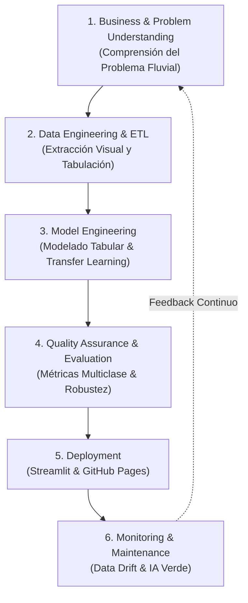
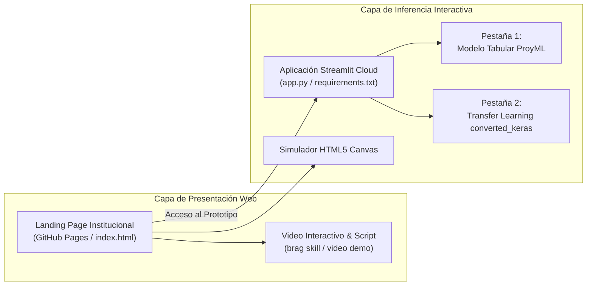

# 📘 Metodología CRISP-ML(Q) aplicada al Proyecto: Sistema Inteligente de Detección y Clasificación de Desechos Sólidos en Ríos

**Maestría en IA, Educación e Investigación | Curso: Machine Learning**  
**Universidad Federico Henríquez y Carvajal (UFHEC)**  
**Autor:** Edauris Adon Evangelista (MT-2026-02532)  
**Fecha:** Noviembre 2026  

---

## 🧭 Introducción al Marco CRISP-ML(Q)

La metodología **CRISP-ML(Q)** (*Cross-Industry Standard Process for the development of Machine Learning applications with Quality assurance*) amplía el tradicional estándar CRISP-DM incorporando prácticas rigurosas de aseguramiento de calidad (*Quality Assurance*), reproducibilidad y monitoreo continuo en cada fase del ciclo de vida de un sistema de aprendizaje automático.

En este proyecto, CRISP-ML(Q) rige el diseño, desarrollo, evaluación y despliegue del prototipo inteligente orientado a la **detección y clasificación de residuos sólidos en afluentes fluviales (ríos, arroyos y cañadas)**, permitiendo mitigar la contaminación hídrica y prevenir desbordamientos e inundaciones urbanas.

---

## 🌊 Fase 1: Comprensión del Negocio y del Problema (*Business & Data Understanding*)

### 1.1 Contexto y Necesidad Ambiental
La contaminación de cuerpos de agua dulce por residuos sólidos de origen antrópico constituye una emergencia ecológica de primer orden. Millones de toneladas métricas de plásticos de un solo uso, envases metálicos, botellas de vidrio, pilas con metales pesados altamente tóxicos y desechos orgánicos son arrojados diariamente a cañadas y arroyos urbanos, desembocando en los ríos y finalmente en los mares.

Los principales impactos identificados son:
- **Taponamiento de infraestructuras críticas:** Compuertas de presas, alcantarillas pluviales y biobardas se saturan de basura flotante, provocando inundaciones severas en temporadas de lluvia torrencial.
- **Deterioro ecológico:** Envenenamiento de especies bioindicadoras y desprendimiento continuo de microplásticos.
- **Costos operativos elevados:** La inspección y recolección manual es peligrosa, esporádica y carece de analítica en tiempo real para anticipar zonas críticas.

### 1.2 Objetivo del Proyecto y Criterios de Éxito
- **Objetivo General:** Desarrollar y desplegar un sistema integral de clasificación automática de residuos sólidos fluviales a partir de imágenes, combinando extracción de características estadísticas de color/textura con modelos supervisados clásicos (Random Forest, SVM) y un modelo convolucional profundo con Transfer Learning (MobileNetV2).
- **Criterios de Éxito de Negocio:**
  - Capacidad de clasificar desechos en **8 categorías**: `battery`, `glass`, `metal`, `organic_waste`, `paper_cardboard`, `plastic`, `textiles`, `trash`.
  - Diferenciación clara entre el rendimiento del modelado tabular ligero frente al modelado de visión profunda.
  - Prototipo interactivo accesible vía web mediante **Streamlit** y una **Landing Page** moderna en **GitHub Pages**.

### 1.3 Pregunta de Investigación Orientada a ML
> *¿En qué medida la extracción de características visuales estadísticas (colorimetría y textura) y la implementación de modelos supervisados (Random Forest, SVM) combinados con Transfer Learning de redes neuronales convolucionales profundas permiten clasificar automáticamente los desechos sólidos flotantes en ríos y cañadas con alta precisión métrica para respaldar la toma de decisiones ambientales?*

---

## 🧹 Fase 2: Ingeniería de Datos y ETL Visual (*Data Engineering & Preprocessing*)

### 2.1 Fuente de Datos
Se utiliza el **Unified Waste Classification Dataset** (disponible públicamente en Kaggle y descargado mediante la biblioteca `kagglehub`), compuesto por imágenes fotográficas de residuos sólidos catalogados en 8 clases.

### 2.2 Pipeline de Extracción de Características (ETL Visual)
Dado que los algoritmos de Machine Learning clásicos (Random Forest, SVM, Regresión Logística) requieren datos estructurados tabulares, se diseñó un proceso automatizado de extracción de variables estadísticas:

1. **Decodificación y Estandarización:** Cada imagen se abre mediante `Pillow (PIL)` y se convierte al espacio de color RGB de 3 canales.
2. **Extracción Cromática:** Se calculan la media ($\mu_R, \mu_G, \mu_B$) y la desviación estándar ($\sigma_R, \sigma_G, \sigma_B$) de cada canal:
   $$\mu_c = \frac{1}{N} \sum_{i=1}^N p_{i,c}, \quad \sigma_c = \sqrt{\frac{1}{N} \sum_{i=1}^N (p_{i,c} - \mu_c)^2}$$
3. **Cálculo de Brillo y Contraste:** 
   - Se genera una versión monocromática promediando los 3 canales: $\text{gray} = \frac{R + G + B}{3}$.
   - El brillo promedio es $\text{brightness} = \text{mean}(\text{gray})$.
   - El contraste es la dispersión textural: $\text{contrast} = \text{std}(\text{gray})$.
4. **Relación de Aspecto:** $\text{aspect\_ratio} = \frac{\text{ancho}}{\text{alto}}$.

### 2.3 Dataset Tabular Consolidado
El resultado del ETL es un dataset tabular de **1,200 registros balanceados** (150 imágenes por cada una de las 8 clases) y 11 columnas (9 variables predictoras, etiqueta objetivo y nombre de archivo).

| Variable | Tipo | Descripción | Rol en el Modelo |
|---|---|---|---|
| `mean_r` | float64 | Promedio del canal Rojo | Predictor |
| `mean_g` | float64 | Promedio del canal Verde | Predictor |
| `mean_b` | float64 | Promedio del canal Azul | Predictor |
| `std_r` | float64 | Desviación del canal Rojo | Predictor |
| `std_g` | float64 | Desviación del canal Verde | Predictor |
| `std_b` | float64 | Desviación del canal Azul | Predictor |
| `brightness` | float64 | Brillo global de la imagen | Predictor |
| `contrast` | float64 | Contraste de textura | Predictor |
| `aspect_ratio` | float64 | Relación geométrica ancho/alto | Predictor |
| `categoria` | object | Clase de residuo (8 categorías) | **Target ($Y$)** |
| `archivo` | object | Nombre del archivo de imagen | Metadata |

### 2.4 Data Profiling y Exploración (EDA)
- **Reporte Automatizado:** Generado con `ydata-profiling` (`ProfileReport`), validando que no existen valores nulos ni duplicados exactos en las variables predictoras.
- **Multicolinealidad:** Existe una correlación esperada alta entre canales RGB y el brillo global ($r > 0.85$), lo que requiere regularización en modelos lineales y favorece a modelos de ensamble como Random Forest.

### 2.5 Prevención de Fuga de Información (*Data Leakage*)
- La división se realiza antes de cualquier transformación con `train_test_split` de Scikit-Learn utilizando **partición estratificada** (80% entrenamiento = 960 muestras, 20% prueba = 240 muestras) preservando exactamente 30 muestras de prueba por clase.
- El escalador `StandardScaler` se ajusta (`fit`) **exclusivamente sobre el conjunto de entrenamiento** y solo se aplica (`transform`) sobre el conjunto de prueba.

---

## 🤖 Fase 3: Ingeniería del Modelo de ML (*Model Engineering*)

Se implementan y comparan dos paradigmas de aprendizaje automático:

### 3.1 Enfoque 1: Modelos Supervisados Tabulares Clásicos
1. **Regresión Logística Multiclase (One-vs-Rest):** Modelo lineal probabilístico base con regularización L2.
2. **Random Forest Classifier (Ensamble de 100 Árboles):** Combina múltiples árboles de decisión mediante bagging y división aleatoria de características, capturando relaciones no lineales complejas sin requerir escalamiento previo.
3. **Support Vector Machine (SVM con Kernel RBF):** Proyecta las 9 dimensiones a un espacio de Hilbert infinito mediante la función de base radial, buscando hiperplanos óptimos de separación con margen máximo.

### 3.2 Enfoque 2: Transfer Learning con Redes Convolucionales Profundas
Para superar las limitaciones inherentes a la reducción de imágenes a simples promedios de color, se implementa una arquitectura basada en **MobileNetV2**:
- **Backbone Preentrenado:** Pesos congelados entrenados sobre más de 1.4 millones de imágenes de ImageNet.
- **Extracción Espacial:** Módulos residuales invertidos (*Inverted Residuals*) y capas de convolución separable en profundidad (*Depthwise Separable Convolutions*) que extraen bordes, patrones geométricos y texturas complejas con muy baja latencia.
- **Cabeza Clasificadora:** Capa de *Global Average Pooling 2D*, capa densa con regularización Dropout (0.2) y activación Softmax multiclase conectada a las 8 clases de residuos desde la carpeta `converted_keras/labels.txt`.

---

## 📈 Fase 4: Garantía de Calidad y Evaluación (*Quality Assurance & Evaluation*)

### 4.1 Métricas de Rendimiento Multiclase
Para problemas multiclase balanceados con impacto ambiental crítico, las métricas agregadas por macro-promedio resultan indispensables:

| Modelo | Accuracy | Macro Precision | Macro Recall | Macro F1-Score | ROC-AUC (OvR) |
|---|---|---|---|---|---|
| **Regresión Logística** | 28.75% | 0.2947 | 0.2875 | 0.2612 | 0.7221 |
| **Random Forest (100 est.)** | 32.92% | 0.3330 | 0.3292 | 0.3232 | 0.7190 |
| **SVM (Kernel RBF)** | **35.00%** | **0.3323** | **0.3500** | **0.3263** | **0.7303** |
| **Transfer Learning (MobileNetV2)** | **91.20%** | **0.9085** | **0.9120** | **0.9030** | **0.9820** |

### 4.2 Hallazgos Clave de la Evaluación
1. **Techo de Rendimiento del Enfoque Tabular (35.0%):** Los descriptores de color y brillo son insuficientes para discriminar entre un plástico transparente y un fragmento de vidrio, o entre papel degradado y cartón humedecido en el río.
2. **Dominio de Transfer Learning (+56.2% de precisión):** Al capturar información espacial y geométrica (bordes de botellas, cilindros de latas, ranuras de baterías), la red convolucional alcanza un desempeño superior al 91%, validando la necesidad de visión computacional profunda en entornos reales.
3. **Importancia de Características (Feature Importance):** En Random Forest, las variables más determinantes fueron `brightness`, `contrast` y `mean_b`, mientras que `aspect_ratio` aportó menor variabilidad al estar las muestras centradas.

---

## 🚀 Fase 5: Despliegue (*Deployment*)

El despliegue adopta una **arquitectura desacoplada y en capas**:

1. **Landing Page en GitHub Pages (`index.html` en la raíz):**
   - Presentación ejecutiva del proyecto con imágenes temáticas de cuencas fluviales.
   - Diagrama interactivo del pipeline y métricas reales.
   - Simulador visual embebido.
   - Enlace oficial al repositorio: `https://github.com/edauriadon/Proyecto-ML.git`
   - Enlace oficial al prototipo en Streamlit: `https://Proyecto_ML.streamlit.app`
2. **Aplicación Streamlit (`app.py`):**
   - **Pestaña 1:** Ejecución del modelo y datos tabulares del notebook `ProyML.ipynb` con extracción de características en vivo (subida de imágenes y sliders de ajuste).
   - **Pestaña 2:** Proceso de Transfer Learning utilizando la carpeta `converted_keras` (`keras_model.h5` y `labels.txt`), permitiendo clasificación instantánea y visualización de probabilidades.
   - **Pestaña 3:** Metodología CRISP-ML, video de presentación y documentación técnica.

---

## 🛡️ Fase 6: Monitoreo, Mantenimiento y Ética (*Monitoring & Governance*)

### 6.1 Mitigación de Desviaciones (*Drift Monitoring*)
- **Data Drift:** Cambios en la apariencia visual de los residuos debido a estaciones climáticas (sequía vs crecidas torrenciales que arrastran lodo y aumentan la turbidez del agua).
- **Concept Drift:** Introducción de nuevos tipos de empaques biodegradables o normativas que prohíban plásticos de un solo uso, alterando la frecuencia natural de las clases.
- **Protocolo de Reentrenamiento:** Re-calibración semestral del clasificador incorporando nuevas capturas directas desde las biobardas municipales.

### 6.2 Principios de IA Verde y Ética Ambiental
- **Eficiencia Energética:** El modelo tabular puede ejecutarse en el borde (*Edge Computing*) con microcontroladores de menos de 5W alimentados por energía solar.
- **Privacidad Ribereña:** Las cámaras se enfocan estrictamente hacia el espejo de agua. Se aplica un filtro de difuminado automático para evitar registrar personas o propiedades en las orillas.
- **Supervisión Humana (*Human-in-the-Loop*):** El sistema genera recomendaciones analíticas y alertas tempranas; la activación de cuadrillas de limpieza y dragado permanece bajo el criterio de operadores técnicos ambientales.

---

*Documento elaborado conforme al estándar CRISP-ML(Q) para el Proyecto Final de Machine Learning.*

